# Terraform Day 1 – AWS VPC, Data Sources, EC2 & S3 Remote Backend

## 1. Project Overview

This project documents my hands-on practice with Terraform and AWS infrastructure provisioning.

I completed four stages of Terraform practice using separate folders and configuration files.

During this lab, I practiced:

- Creating AWS networking infrastructure using Terraform.
- Retrieving existing AWS resources using Terraform Data Sources.
- Creating and attaching an Internet Gateway to an existing VPC.
- Using Terraform variables and `.tfvars` files.
- Configuring an Amazon S3 remote backend.
- Managing separate Terraform state files.
- Deploying an EC2 instance using existing networking resources.
- Troubleshooting AWS and Terraform errors.

## 2. Technologies Used

| Technology | Purpose |
|---|---|
| Terraform | Infrastructure as Code |
| AWS VPC | Virtual networking |
| Subnets | Network segmentation |
| Internet Gateway | Internet connectivity |
| Route Tables | Network traffic routing |
| Security Groups | Instance-level traffic control |
| AWS EC2 | Virtual machine deployment |
| Amazon S3 | Remote Terraform state storage |
| Terraform Data Sources | Retrieve existing AWS resources |
| VS Code | Terraform code editor |

## 3. Project Architecture

### Architecture Diagram

The following diagram shows the complete architecture and resource flow across the four stages of my Terraform hands-on practice.

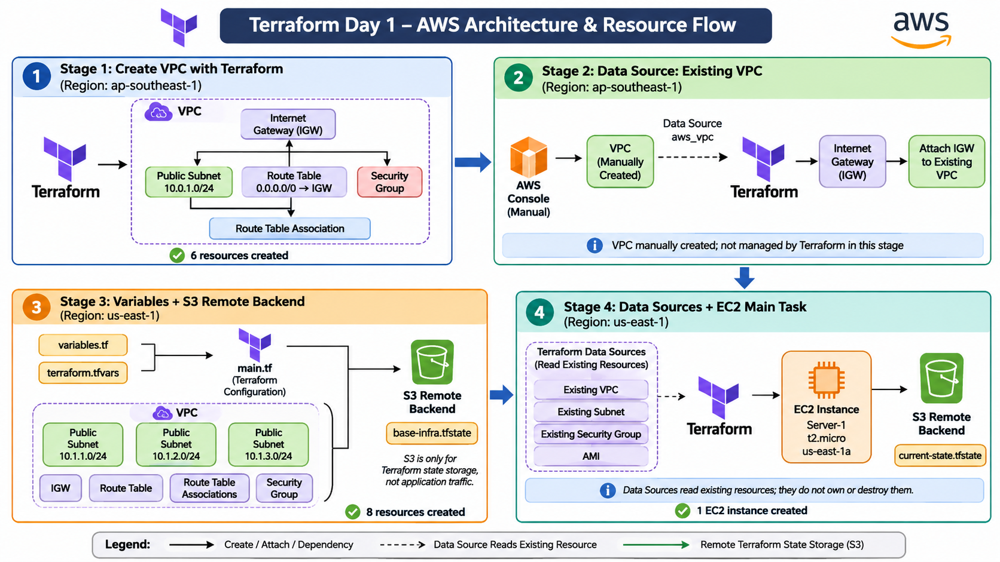

### Architecture Flow

1. **Stage 1 – VPC with Terraform:** Created AWS networking resources using Terraform.
2. **Stage 2 – Data Sources:** Manually created a VPC and used a Terraform Data Source to retrieve it. Created and attached an Internet Gateway.
3. **Stage 3 – S3 Remote Backend:** Used variables and configured an S3 remote backend to store the base infrastructure state.
4. **Stage 4 – Main Task:** Used Data Sources to retrieve existing networking resources and deployed an EC2 instance using a separate Terraform state file.

## 4. Hands-on Lab – Step by Step

### Stage 1: AWS VPC Networking with Terraform

**Folder:** `Terraform-lab/`

**File:** `main.tf`

In this stage, I created AWS networking resources using Terraform.

**Resources created:**

1. VPC
2. Public Subnet
3. Internet Gateway
4. Route Table
5. Route Table Association
6. Security Group

I learned how Terraform resource references connect resources.

For example:

- The Internet Gateway uses the VPC ID.
- The subnet uses the VPC ID.
- The route table uses the Internet Gateway ID.
- The route table association uses the subnet ID and route table ID.

**Terraform commands practiced:**

```bash
terraform init
terraform fmt
terraform validate
terraform plan
terraform apply
terraform state list
terraform destroy
```

**Deployment result:** 6 resources added successfully.

**Screenshot Evidence:**

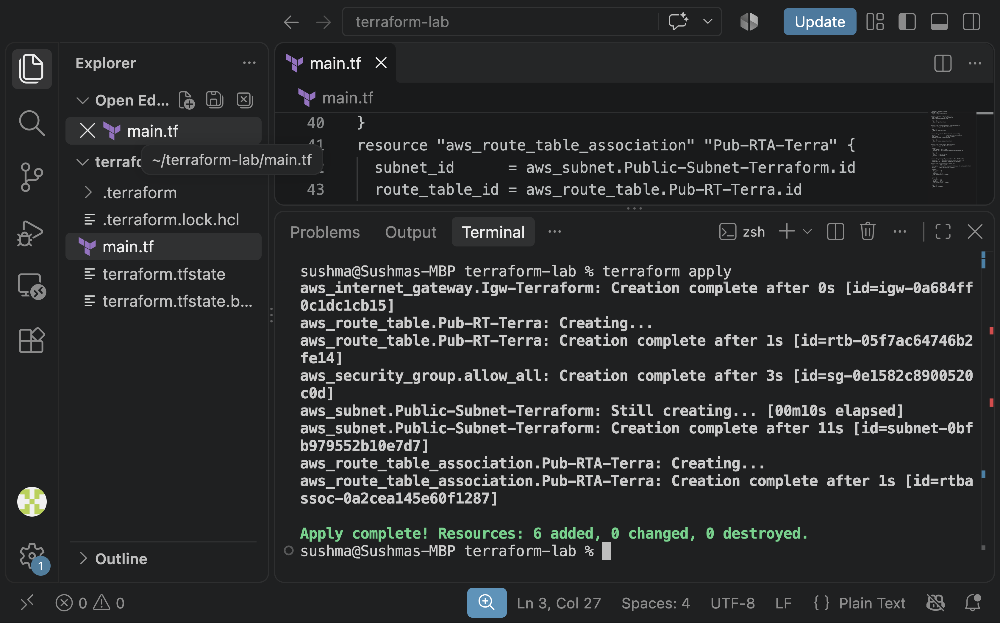

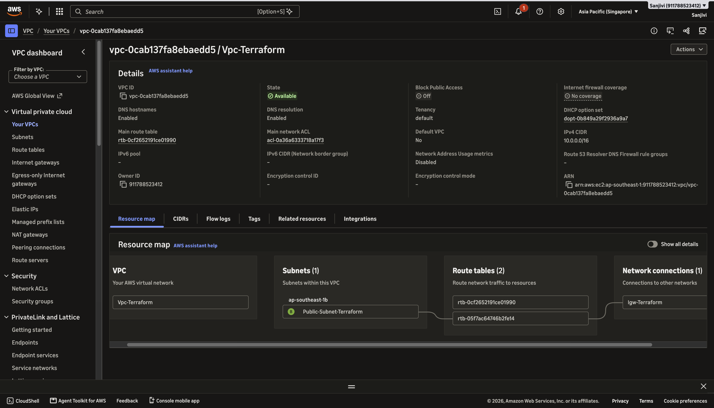

### Stage 2: Terraform Data Sources

**Folder:** `data-source/`

**File:** `data-source.tf`

In this stage, I manually created a VPC using the AWS Console.

Instead of creating another VPC through Terraform, I used a Data Source to retrieve the existing VPC using its VPC ID.

Then I used the retrieved VPC ID to create and attach an Internet Gateway through Terraform.

**What I practiced:**

- Manually creating a VPC in AWS.
- Using `data "aws_vpc"` to retrieve an existing VPC.
- Referencing the VPC ID from a Data Source.
- Creating an Internet Gateway using `aws_internet_gateway`.
- Attaching the Internet Gateway to an existing VPC.
- Destroying the Terraform-managed Internet Gateway after testing.

**Important:** The VPC was manually created. The Internet Gateway was created and managed by Terraform.

**Screenshot Evidence:**

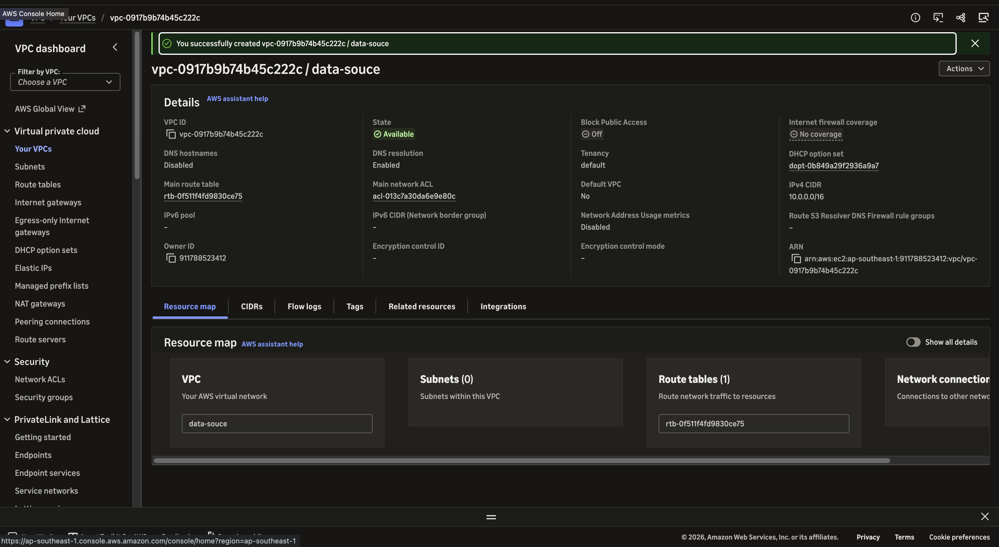

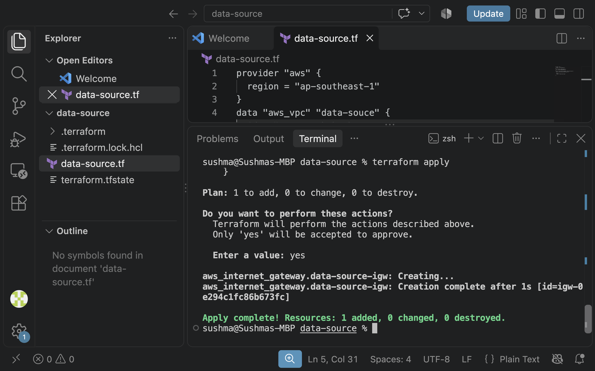

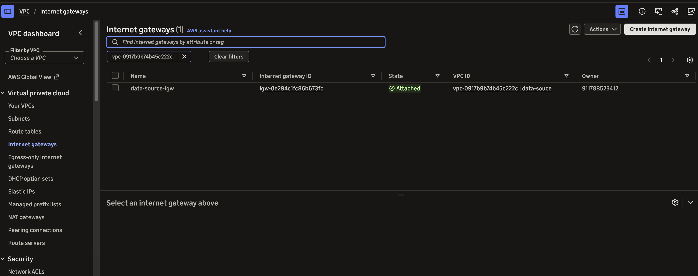

### Stage 3: Terraform Variables and S3 Remote Backend

**Folder:** `S3-backend/Terraformsingleinstance/`

**Files:**

- `main.tf`
- `variables.tf`
- `terraform.tfvars`

In this stage, I modified the trainer's Terraform configuration to create base networking infrastructure and configure an S3 remote backend.

**Resources created:**

1. VPC
2. Three Public Subnets
3. Internet Gateway
4. Route Table
5. Route Table Association
6. Security Group

**Terraform variables:**

- `variables.tf` – Declares variables.
- `terraform.tfvars` – Provides variable values.
- `main.tf` – Contains Terraform resources and backend configuration.

**S3 Remote Backend Configuration:**

| Configuration | Value |
|---|---|
| Bucket | `sushma-devops-terraform-state-2026-123` |
| Region | `us-east-1` |
| State key | `base-infra.tfstate` |

I verified that Terraform successfully stored the state file in the S3 bucket.

**Deployment result:** 8 resources added successfully.

**Screenshot Evidence:**

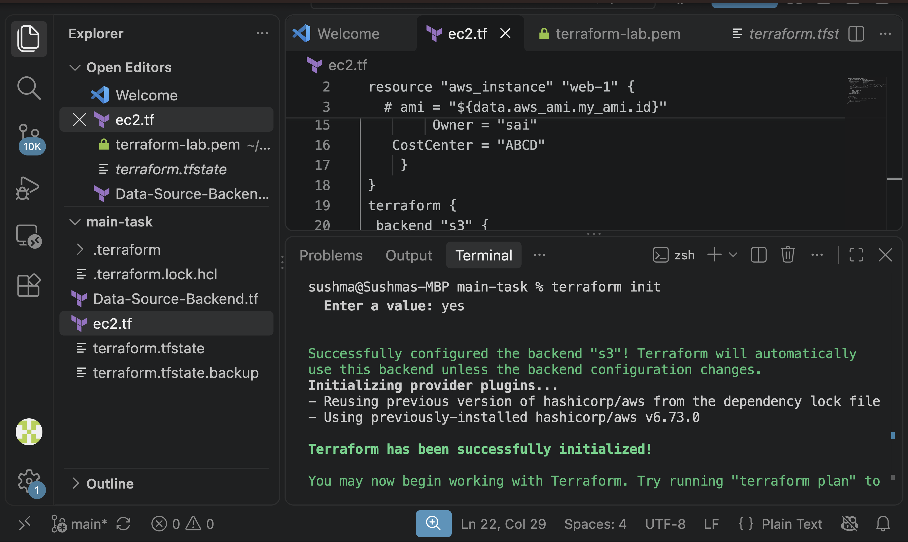

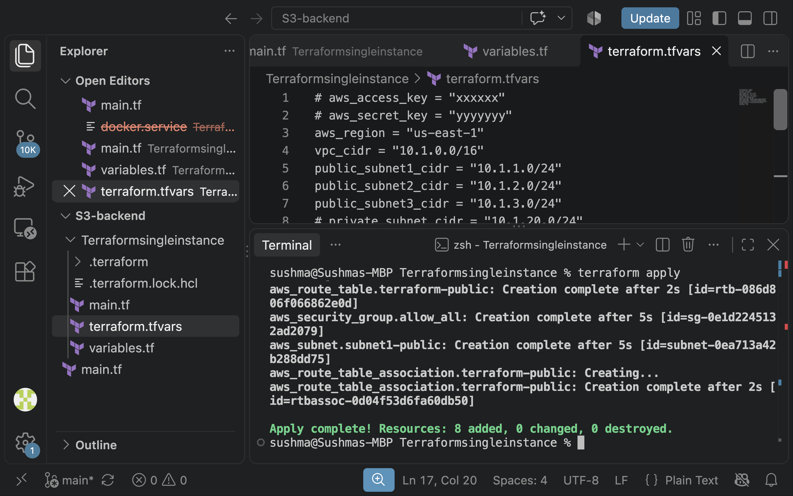

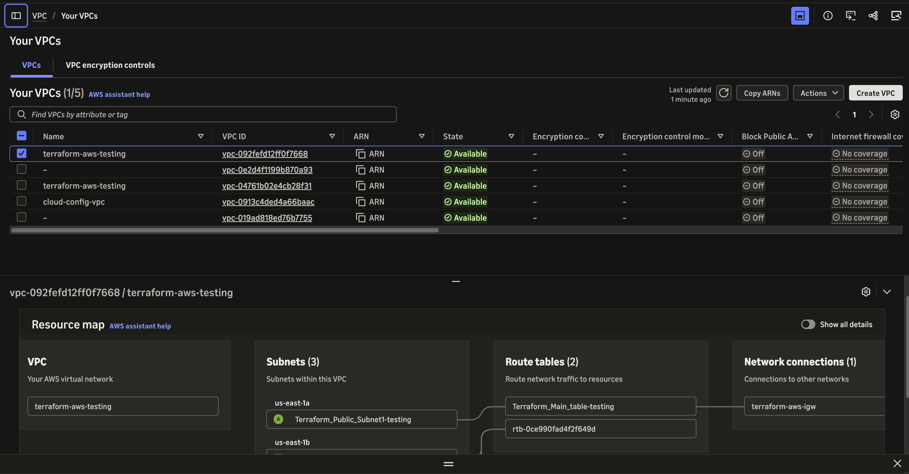

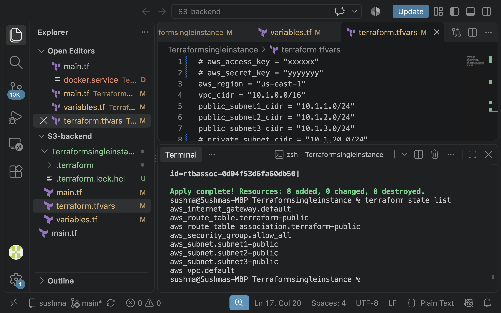

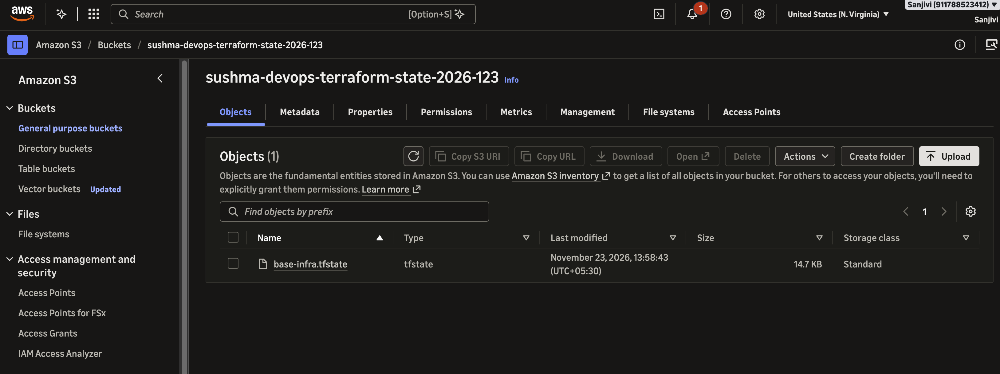

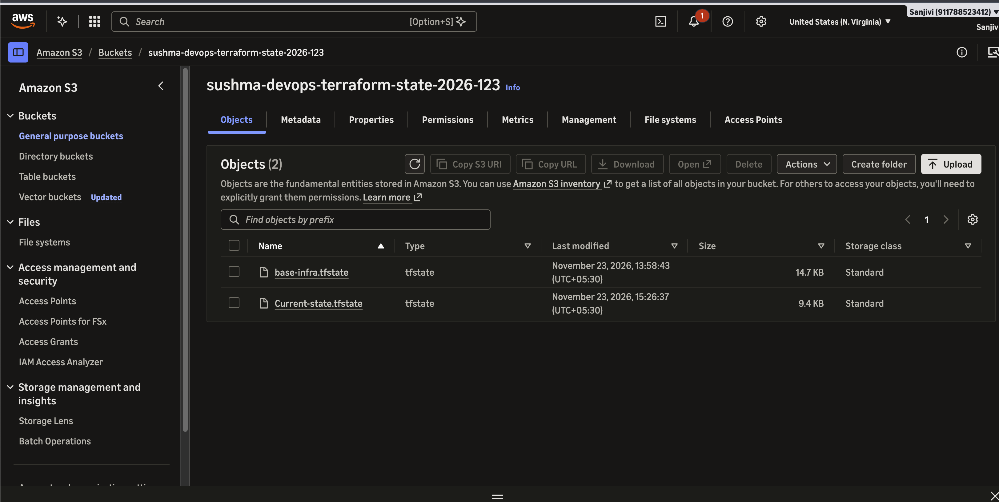

### Stage 4: Terraform Data Sources and EC2 Deployment

**Folder:** `main-task/`

**Files:**

- `Data-Source-Backend.tf`
- `ec2.tf`

In this stage, I used Data Sources to retrieve existing AWS infrastructure resources.

**Resources retrieved using Data Sources:**

- Existing VPC
- Existing Subnet
- Existing Security Group
- Existing AMI

I used the retrieved information to create an EC2 instance.

**EC2 Configuration:**

| Configuration | Value |
|---|---|
| Terraform resource | `aws_instance.web-1` |
| Instance name | `Server-1` |
| Instance type | `t2.micro` |
| Availability Zone | `us-east-1a` |
| Region | `us-east-1` |

**S3 Backend State File:**

`current-state.tfstate`

The base networking and EC2 configurations used separate S3 state keys.

| Configuration | State file |
|---|---|
| Base infrastructure | `base-infra.tfstate` |
| EC2 main task | `current-state.tfstate` |

These are independent Terraform state files. They are not automatically merged.

**Deployment result:** 1 EC2 instance added successfully.

**Screenshot Evidence:**

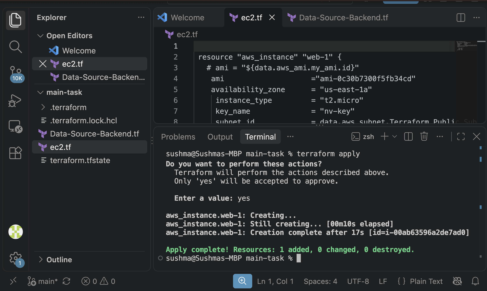

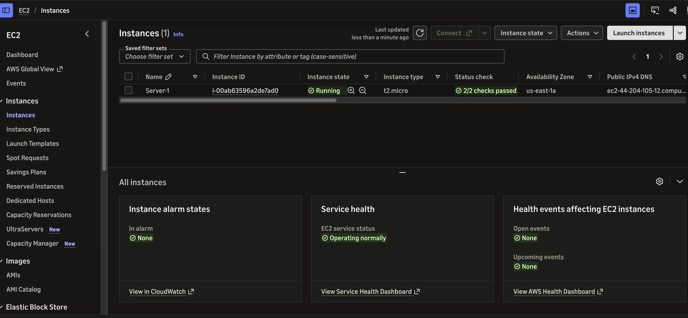

## 5. What I Learned

Through this hands-on project, I learned:

1. How to provision AWS infrastructure using Terraform.
2. How to create VPC networking resources.
3. How Terraform resource references establish dependencies.
4. The difference between Terraform Resources and Data Sources.
5. How to retrieve existing AWS resources using Data Sources.
6. How to create an Internet Gateway for an existing VPC.
7. How to use variables and `.tfvars` files.
8. How to configure an S3 remote backend.
9. How to store Terraform state remotely in S3.
10. How to use separate state files for separate Terraform configurations.
11. How to deploy EC2 instances using existing networking resources.
12. How to inspect resources using `terraform state list`.
13. How to troubleshoot AWS quota and Terraform backend errors.
14. How to destroy Terraform-managed resources safely.

## 6. Troubleshooting and Issues Faced

### Issue 1: VPC Limit Exceeded

**Error:**

```text
VpcLimitExceeded: The maximum number of VPCs has been reached
```

**Cause:**

The AWS account had reached its VPC quota in the selected region.

**How I fixed it:**

1. Opened the AWS VPC Console.
2. Checked the existing VPCs.
3. Identified an unused VPC: `vpc-03e0d2778c5403fce`.
4. Verified that it had no subnets or network connections and only the main route table.
5. Deleted the unused VPC to free the VPC quota.
6. Retried the Terraform deployment successfully.

**What I learned:** AWS service quotas can prevent Terraform from creating resources. Checking existing infrastructure and regional quotas is important before provisioning new resources.

### Issue 2: S3 Backend – NoSuchBucket

**Error:**

```text
NoSuchBucket
```

**Cause:**

The S3 bucket configured in the Terraform backend had been deleted.

**What I learned:**

- Terraform requires the configured S3 bucket to initialize and access remote state.
- Deleting an S3 state bucket does not automatically delete the actual AWS infrastructure.
- Changing backend configuration does not restore a deleted state file.
- Existing AWS resources are not automatically imported into a new Terraform state.

### Issue 3: VPC and Networking Resources Remained After EC2 Destroy

**Observation:**

After destroying the EC2 instance in the `main-task` configuration, the existing VPC and networking resources remained.

**Reason:**

The `main-task` configuration used Data Sources to read networking resources managed by another Terraform configuration.

**What I learned:**

Terraform destroys resources tracked in the active state. Data Sources read existing resources; they do not manage or own those resources.

### Issue 4: Separate Terraform State Files

**Observation:**

The S3 bucket contained:

- `base-infra.tfstate`
- `current-state.tfstate`

**What I learned:**

Each Terraform configuration can maintain its own state file using a different S3 backend key. Separate state files track separate sets of managed resources.

## 7. Cleanup

After completing the hands-on exercises, I destroyed the Terraform-managed resources used in the labs.

This helped me practice the Terraform resource lifecycle:

```bash
terraform apply
terraform state list
terraform destroy
```

The S3 state bucket was also part of the backend cleanup and troubleshooting practice.

## 8. Project Structure

```text
Day-01/
│
├── Terraform-lab/
│   ├── main.tf
│   └── .terraform.lock.hcl
│
├── data-source/
│   └── data-source.tf
│
├── S3-backend/
│   └── Terraformsingleinstance/
│       ├── main.tf
│       ├── variables.tf
│       └── terraform.tfvars
│
├── main-task/
│   ├── Data-Source-Backend.tf
│   └── ec2.tf
│
├── screenshots/
│   ├── architecture.png
│   ├── 01-terraform-vpc-network-apply-success.png
│   ├── 02-terraform-vpc-resource-map.png
│   ├── 03-data-source-manually-created-vpc.png
│   ├── 04-data-source-internet-gateway-apply-success.png
│   ├── 05-data-source-internet-gateway-attached.png
│   ├── 07-s3-backend-base-infrastructure-apply-and-state-list.png
│   ├── 08-s3-remote-backend-state-file.png
│   ├── 09-main-task-ec2-instance-apply-success.png
│   ├── 10-main-task-ec2-instance-running.png
│   ├── 11-main-task-s3-backend-init-success.png
│   ├── 12-s3-backend-two-separate-state-files.png
│   ├── 13-s3-backend-base-vpc-and-networking.png
│   └── 14-s3-backend-base-infrastructure-apply-success.png
│
└── README.md
```

## 9. Security Notes

- Terraform state files are excluded from GitHub.
- AWS access keys and secret keys must not be committed.
- Private `.pem` keys must not be uploaded.
- The `.terraform/` directory is excluded from GitHub.
- The Security Group in the first learning lab allows all inbound traffic from `0.0.0.0/0`. This is only a learning configuration and is not recommended for production.

## 10. Conclusion

This project gave me practical experience with Terraform and AWS infrastructure provisioning.

I practiced creating VPC networking, retrieving existing resources through Data Sources, configuring an S3 remote backend, managing separate state files, and deploying EC2 instances.

I also learned how to troubleshoot VPC quota errors, S3 backend issues, and Terraform state management.

This hands-on project strengthened my understanding of Infrastructure as Code and AWS resource management.

---

**Project Type:** Personal Hands-on Learning Project  
**Day:** 01  
**Focus:** Terraform and AWS
